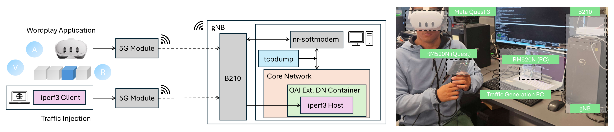

# 5G × Headsets: OAI 5G Setup Tutorial for Meta Quest 3

[](https://doi.org/10.1145/3842656.3843826)
[](https://doi.org/10.1145/3842656.3843826)
[](https://creativecommons.org/licenses/by/4.0/)

This repository contains the 5G testbed setup tutorial for the **ACM ImmerCom 2026** (co-located with ACM MobiCom 2026) paper: *"[5G × Headsets: An Application-Level Measurement Study of 5G Latency for Networked Immersive XR](https://doi.org/10.1145/3842656.3843826)"*.

* **Authors**

[Tianyuan (Alex) Du](https://gorlatova.pratt.duke.edu/people/tianyuan-alex-du), [Hanting Ye](https://gorlatova.pratt.duke.edu/people/hanting-ye), Yiming Li, [Tianyi Hu](https://gorlatova.pratt.duke.edu/people/tianyi-hu), [Tingjun Chen](https://github.com/tingjunchen), and [Maria Gorlatova](https://maria.gorlatova.com/) — Duke University

* **Description**

This tutorial shows how to give a commercial Meta Quest 3 headset 5G connectivity using an open-source standalone 5G network. The testbed is built on [OpenAirInterface (OAI)](https://openairinterface.org/): the gNB (`nr-softmodem` with a USRP B210, band n78, 106 PRBs) and the containerized OAI 5G core run together on a single workstation. Because the Meta Quest 3 has no cellular connectivity, a Quectel RM520N-GL 5G module connects the headset to the network as a USB Ethernet device.

This repository covers the 5G network and headset connectivity setup used in the paper. The XR application, traffic injection, and measurement analysis are outside its scope.



*Left: overview of the 5G testbed. Right: hardware of the system. The 5G modules (RM520N-GL) connect wirelessly to the gNB (Dell XPS 8930 with a USRP B210) and by wire to the Meta Quest 3 and the traffic generation PC.*

## Publication

Tianyuan Du, Hanting Ye, Yiming Li, Tianyi Hu, Tingjun Chen, and Maria Gorlatova. 2026. 5G × Headsets: An Application-Level Measurement Study of 5G Latency for Networked Immersive XR. In *Proceedings of the 4th ACM Workshop on Mobile Immersive Computing, Networking, and Systems (ImmerCom '26)*. ACM, 8–14. [DOI](https://doi.org/10.1145/3842656.3843826)

Please cite the following paper in your publications if this tutorial helps your research.

```bibtex
@inproceedings{Du26FiveGHeadsets,
  title     = {{5G} $\times$ Headsets: An Application-Level Measurement Study of {5G} Latency for Networked Immersive {XR}},
  author    = {Du, Tianyuan and Ye, Hanting and Li, Yiming and Hu, Tianyi and Chen, Tingjun and Gorlatova, Maria},
  booktitle = {Proceedings of the 4th ACM Workshop on Mobile Immersive Computing, Networking, and Systems (ImmerCom '26)},
  publisher = {ACM},
  pages     = {8--14},
  year      = {2026},
  doi       = {10.1145/3842656.3843826}
}
```

## Acknowledgments

The contributors of this tutorial are Yiming Li and Tianyuan Du. This is a joint effort of the [FUNctions Lab](https://github.com/functions-lab) and the [Intelligent Interactive Internet of Things (I3T) Lab](https://gorlatova.pratt.duke.edu/) at Duke University.

This work was supported by NSF grants ECCS-2434131, CNS-2443137, CNS-2450567, CSR-2312760, CNS-2112562, IIS-2231975, CAREER IIS-2046072, NAIAD 2332744, and ITE-2453803, along with Cisco and Meta Research Awards.

## Contact

For questions on this repository or the related paper, please contact Yiming Li at yiming.li [AT] duke [DOT] edu or Tianyuan Du at alex.du [AT] duke [DOT] edu, or open an issue in this repository.

## License

This tutorial is licensed under the [Creative Commons Attribution 4.0 International License](https://creativecommons.org/licenses/by/4.0/). See the [LICENSE](LICENSE) file for details.

## Tutorial

* [Prerequisites](#prerequisites)
* [I. Devices Info](#i-devices-info)
* [II. Module Setup (One-Time)](#ii-module-setup-one-time)
* [III. Cold Start](#iii-cold-start)
* [IV. Stop](#iv-stop)
* [V. Restart](#v-restart)
* [VI. Add User (Flash SIM Card)](#vi-add-user-flash-sim-card)

> [!NOTE]
> This cookbook assumes you are running the exact device configurations listed in the [Devices Info](#i-devices-info) section. It does not repeat the upstream installation steps; see [Prerequisites](#prerequisites) for where to find them.
>
> **Do not use this guide to set up systems with different hardware/software configurations.**
>
> This guide assumes the PLMN `00101` is used throughout the deployment.

### Prerequisites

This tutorial starts from a machine on which the OAI gNB and 5G core are already installed. We followed the upstream OpenAirInterface tutorials for the installation and kept their default configurations; the only change is the subscriber information (IMSI, KEY, and OPC) described in [Add User](#vi-add-user-flash-sim-card).

* **OAI 5G core (`~/oai-cn5g`):** [NR SA Tutorial: OAI CN5G](https://gitlab.eurecom.fr/oai/openairinterface5g/-/blob/develop/doc/NR_SA_Tutorial_OAI_CN5G.md)
* **UHD, OAI gNB with USRP B210 (`~/openairinterface5g`), and SIM card programming:** [NR SA Tutorial: COTS UE](https://gitlab.eurecom.fr/oai/openairinterface5g/-/blob/develop/doc/NR_SA_Tutorial_COTS_UE.md)
* **SIM card tool (`~/sim_card/pysim`):** [pySim](https://github.com/osmocom/pysim), installed in a conda environment named `sim_card`
* **Host tools:** `linux-tools` (`cpupower`), `cpufrequtils` (`cpufreq-set`), `lm-sensors` (`sensors`), `i8kutils` (`i8kctl`), `pcsc-tools` (`pcsc_scan`), and `minicom` (AT commands)

The host tuning applied on top of the upstream installation is listed in [Devices Info](#i-devices-info).

**First-time setup order.** [Cold Start](#iii-cold-start) describes the routine procedure once everything is configured. When bringing up a new SIM card and module for the first time, follow this order:

1. Flash the SIM card and add the user to the core network database ([Add User](#vi-add-user-flash-sim-card)).
2. Start the core network and the gNB ([Cold Start](#iii-cold-start), steps 1–5).
3. Configure the module ([Module Setup](#ii-module-setup-one-time)); its network scan requires the gNB to be on air.
4. Connect the module to the headset ([Cold Start](#iii-cold-start), steps 6–7).

> [!IMPORTANT]
> The gNB transmits in NR band n78 (3.5 GHz). Make sure you are authorized to transmit in this band at your location, or operate in a shielded environment.

### I. Devices Info

* **PC (gNB + Core Network):** Dell XPS 8930 with Intel i7-9700K CPU, 16 GB RAM, Ubuntu 24.04 LTS
  * BIOS:
    * Upgraded from 1.1.5 to 1.1.31.
    * Intel SpeedStep: Enabled.
    * Intel Speed Shift: Enabled.
    * Performance Options -> Overclocking Feature: Disabled.
  * OS:
    * Installed the low-latency kernel (`6.8.0-90-lowlatency`) and updated GRUB.
    * Updated the default GRUB command line to disable all CPU mitigations.
    * Granted the user the privilege to set real-time priority up to 99.
    * Installed `i8kutils` to take over the default fan control.
    * Created a polkit rule to authorize the user to access `pcscd` without `sudo`.
  * Hardware:
    * Re-applied thermal paste.
    * Cleaned the CPU cooler/fan.
* **SDR:** USRP B210 (USB 3.0), NR band n78 (3.5 GHz), 106 PRBs
* **Software:** OAI gNB (`nr-softmodem`) and OAI 5G core (`develop` Docker images) with their default configurations, UHD 4.8.0
* **UE:** Two Quectel RM520N-GL modules (one for the Meta Quest 3, one for the traffic generation PC), each on a Waveshare M.2-to-USB adapter board, firmware upgraded from `RM520NGLAAR03A01M4G_01.202.01.202` to `RM520NGLAAR03A03M4G_A0.304.A0.304`
* **XR headset:** Meta Quest 3
* **Traffic generation PC (optional, used for the measurements in the paper):** Lambda TensorBook with Ubuntu 22.04
* **SIM card:** sysmoISIM-SJA5-9FV
* **Smart card reader:** HID OMNIKEY 3121 (PC/SC)

### II. Module Setup (One-Time)

A factory-image RM520N-GL must be configured once to connect to the OAI gNB. Connect the module to a PC over USB and send the following AT commands in order over its AT serial port (e.g., with `minicom`). The gNB must be running for the network scan and PLMN selection. The settings are stored on the module, so this does not need to be repeated after a cold boot.

```text
# Factory reset
AT+QPRTPARA=3

# Set to airplane mode to disable the modem before configuration
AT+CFUN=4

# Configure the APN settings for the 5G network
AT+QICSGP=1,1,"oai","","",1

# Reboot the module to apply changes and exit airplane mode
AT+CFUN=1,1

# Check the carrier policy list built into the firmware
# ("ROW_Commercial" works for PLMN 00101)
AT+QMBNCFG="list"
# Expected response:
#   +QMBNCFG: "List",0,1,1,"ROW_Commercial",0x0A010809,202401151

# Perform a network scan; you should see 00101 in the results
AT+QSCAN=3,1

# Manually select the PLMN to connect to the OAI gNB: PLMN 001/01 on NR (RAT 12)
AT+COPS=1,2,"00101",12

# Set the USB mode to ECM, which enables auto-activation of the first PDP context
AT+QCFG="usbnet",1

# Reboot the module to apply changes
AT+CFUN=1,1
```

### III. Cold Start

#### 1. OS Preparation

1. Reboot the PC. When the GRUB menu appears, select `Advanced options for Ubuntu`, then choose `Ubuntu, with Linux 6.8.0-90-lowlatency`.

2. Verify that Ubuntu is using the low-latency kernel:

   ```bash
   uname -r
   ```

   ```console
   6.8.0-90-lowlatency
   ```

3. Verify that the current user has the privileges required to set real-time process priority up to 99:

   ```bash
   ulimit -r
   ```

   ```console
   99
   ```

#### 2. SDR (USRP B210) Preparation

1. Mount two antennas to the **RF-A** `TX/RX` and `RX2` ports.
2. Connect the 12V power supply to the B210.
3. Connect the B210 to a USB 3.0 port on the computer using a USB 3.0 cable. USB 3.0 ports are typically blue or marked with "USB 3.0" or the "SS" (SuperSpeed) symbol.
4. Verify the connection by running the following commands in the terminal and checking the output (the `product: B210` line and the `5000M` link speed):

   ```bash
   sudo uhd_find_devices
   ```

   ```console
   [INFO] [UHD] linux; GNU C++ version 13.3.0; Boost_108300; UHD_4.8.0.HEAD-0-g308126a4
   --------------------------------------------------
   -- UHD Device 0
   --------------------------------------------------
   Device Address:
       serial: <YOUR_SERIAL_HERE>
       name: <YOUR_DEVICE_NAME>
       product: B210
       type: b200
   ```

   ```bash
   lsusb -t
   ```

   ```console
   /:  Bus 001.Port 001: Dev 001, Class=root_hub, Driver=xhci_hcd/16p, 480M
       |__ Port 008: Dev 002, If 0, Class=Wireless, Driver=btusb, 12M
       |__ Port 008: Dev 002, If 1, Class=Wireless, Driver=btusb, 12M
       |__ Port 013: Dev 003, If 0, Class=Human Interface Device, Driver=usbhid, 1.5M
   /:  Bus 002.Port 001: Dev 001, Class=root_hub, Driver=xhci_hcd/10p, 5000M
   /:  Bus 003.Port 001: Dev 001, Class=root_hub, Driver=xhci_hcd/2p, 480M
   /:  Bus 004.Port 001: Dev 001, Class=root_hub, Driver=xhci_hcd/2p, 10000M
       |__ Port 001: Dev 002, If 0, Class=Vendor Specific Class, Driver=[none], 5000M
       |__ Port 001: Dev 002, If 1, Class=Vendor Specific Class, Driver=[none], 5000M
       |__ Port 001: Dev 002, If 2, Class=Vendor Specific Class, Driver=[none], 5000M
       |__ Port 001: Dev 002, If 3, Class=Vendor Specific Class, Driver=[none], 5000M
       |__ Port 001: Dev 002, If 4, Class=Vendor Specific Class, Driver=[none], 5000M
   ```

> [!NOTE]
> Ensure the USB link speed is `5000M`, which indicates a successful USB 3.0 connection. If you see `480M`, try reconnecting the B210 to a different port.

#### 3. CPU/Fan Preparation

1. Set the fans to maximum speed to prevent thermal throttling from interrupting OAI processes.

   ```bash
   sudo systemctl stop i8kmon
   i8kctl fan 2 2
   ```

2. Disable CPU idle states, set the CPU to performance mode, and lock the frequency to 4.4 GHz.

   ```bash
   sudo cpupower idle-set -D 0
   for ((i=0;i<$(nproc);i++)); do sudo cpufreq-set -c $i -r -g performance; done
   sudo cpupower frequency-set -g performance
   sudo cpupower frequency-set --min 4.40GHz --max 4.40GHz --governor performance
   ```

3. Verify the CPU frequency and fan speed. You should hear the fans running at full speed. Monitor them in real-time (run each command in its own terminal):

   ```bash
   watch -n 1 sensors
   watch -n 1 "grep MHz /proc/cpuinfo"
   ```

> [!NOTE]
> The i7-9700K supports an all-core max boost frequency of 4.6 GHz. However, extensive testing on the XPS 8930 indicates that locking the frequency above 4.4 GHz can cause instability under high load, even with fans at maximum speed.

#### 4. OAI-CN (Core Network) Setup

1. Start the CN services:

   ```bash
   cd ~/oai-cn5g
   docker compose up -d
   ```

2. Verify container health and logs to ensure the CN is running properly before proceeding to the RAN setup:

   ```bash
   docker compose ps
   docker compose logs -f
   ```

   All containers (e.g., `oai-amf`, `oai-smf`, `oai-upf`) should show a `(healthy)` status. Resolve any unhealthy containers before proceeding. Example of the expected healthy status:

   ```console
   NAME         IMAGE                                    SERVICE      STATUS
   ims          oaisoftwarealliance/ims:latest           ims          Up 2 minutes (healthy)
   mysql        mysql:8.0                                mysql        Up 2 minutes (healthy)
   oai-amf      oaisoftwarealliance/oai-amf:develop      oai-amf      Up 21 seconds (healthy)
   oai-ausf     oaisoftwarealliance/oai-ausf:develop     oai-ausf     Up 22 seconds (healthy)
   oai-ext-dn   oaisoftwarealliance/trf-gen-cn5g:jammy   oai-ext-dn   Up 2 minutes (healthy)
   oai-nrf      oaisoftwarealliance/oai-nrf:develop      oai-nrf      Up 2 minutes (healthy)
   oai-smf      oaisoftwarealliance/oai-smf:develop      oai-smf      Up 20 seconds (healthy)
   oai-udm      oaisoftwarealliance/oai-udm:develop      oai-udm      Up 23 seconds (healthy)
   oai-udr      oaisoftwarealliance/oai-udr:develop      oai-udr      Up 23 seconds (healthy)
   oai-upf      oaisoftwarealliance/oai-upf:develop      oai-upf      Up 19 seconds (healthy)
   ```

#### 5. OAI-RAN (Radio Access Network) Setup

1. Start the RAN services (keep this terminal session open):

   ```bash
   cd ~/openairinterface5g/cmake_targets/ran_build/build
   sudo ./nr-softmodem -O ../../../targets/PROJECTS/GENERIC-NR-5GC/CONF/gnb.sa.band78.fr1.106PRB.usrpb210.conf -E --continuous-tx
   ```

2. Verify console output:

   * The gNB is running successfully if you see standard framing logs:

     ```console
     [NR_MAC] Frame.Slot 768.0
     [NR_MAC] Frame.Slot 896.0
     ```

   * The UE has successfully connected if you see the Random Access (RA) procedure and RRC connection logs:

     ```console
     [NR_MAC] 91.19 UE RA-RNTI 010b TC-RNTI 584f: initiating RA procedure
     [NR_RRC] [UL] (cellID bc614e, UE ID 1 RNTI 584f) Received RRCSetupComplete (RRC_CONNECTED reached)
     [NGAP]   Create UE context (ID 1) for AMF 'OAI-AMF' (assoc_id 5)
     ```

   * You should **NOT** see continuous red errors or repeated `UUULLLLLLLLL` output (indicating hardware underrun/overrun).

#### 6. RM520N-GL Setup

Mount antennas to all four ports using the same antenna type (the included GPS antenna is not required).

The RM520N-GL runs automatically without additional setup. Once powered, it will attempt to connect to the 5G network.

> [!NOTE]
> This assumes the module has already been configured once as described in the [Module Setup](#ii-module-setup-one-time) section. The configuration is stored on the module and persists across cold boots.

#### 7. Meta Quest 3 Setup

1. Connect the RM520N-GL to the USB-C port of the Meta Quest 3. The module is preset to USB Ethernet (ECM) mode, so the headset sees it as a standard USB Ethernet interface.
2. Disable Wi-Fi on the headset so that all traffic goes through the 5G link.

No additional software or configuration is required on the headset.

3. Verify the connection:

   * In the gNB console, the module appears as a connected UE (see the RRC connection logs in step 5), followed by periodic per-UE statistics.
   * On the headset, with Wi-Fi disabled, confirm that it still has network access (e.g., load a web page in the browser). All of its traffic now goes through the 5G network.

### IV. Stop

#### 1. Stop the CN

```bash
cd ~/oai-cn5g
docker compose down -v
```

#### 2. Stop the RAN

Terminate the softmodem process by pressing `Ctrl+C` in the terminal.

#### 3. (Optional) Restore CPU/Fan States

The easiest way to restore system settings is to reboot. To restore manually:

```bash
# Restore CPU control
sudo cpupower idle-set -E
sudo cpupower frequency-set --min 800MHz --max 4.60GHz --governor powersave

# Restore Fan control
i8kctl fan 1 1
sudo systemctl start i8kmon
```

### V. Restart

1. Turn off the UE (module).
2. Restart the CN:

   ```bash
   cd ~/oai-cn5g
   docker compose down -v
   docker compose up -d
   ```

3. Restart the RAN (terminate via `Ctrl+C`, then relaunch):

   ```bash
   cd ~/openairinterface5g/cmake_targets/ran_build/build
   sudo ./nr-softmodem -O ../../../targets/PROJECTS/GENERIC-NR-5GC/CONF/gnb.sa.band78.fr1.106PRB.usrpb210.conf -E --continuous-tx
   ```

### VI. Add User (Flash SIM Card)

#### 1. Prepare the SIM Card Reader

Plug the HID OMNIKEY 3121 SIM card reader into the PC. Verify access to the PC/SC reader without `sudo`:

```bash
pcsc_scan
```

```console
PC/SC device scanner
Scanning present readers...
0: HID Global OMNIKEY 3x21 Smart Card Reader [OMNIKEY 3x21 Smart Card Reader] 00 00
```

#### 2. Prepare the New User Info

Each user in the 5G network must have a unique IMSI, and is authenticated with a KEY and an OPC. Choose your own KEY and OPC (32 hex digits each); they may be shared across users, but the values flashed to the SIM card must match those in the CN database.

The IMSI:

* Must be pure numeric, 15 digits.
* Starts with `00101` (per our PLMN).
* Must not exist in the current database.

Example: `001010100016069`

Check existing IMSIs:

```bash
grep "00101" ~/oai-cn5g/database/oai_db.sql
```

#### 3. Flash the SIM Card

Look up your sysmoISIM-SJA5-9FV's ADM key (provided by the SIM card vendor with your order) using the **last row of digits** printed on the nano SIM. This matches the ICCID.

> [!WARNING]
> Do **NOT** use the IMSI printed on the external SIM card holder to look up the ADM key. Make sure you use the correct ADM key; three failed attempts will **permanently** lock the SIM card!

Replace `<ADM>`, `<ICCID>`, `<IMSI>`, `<KEY>`, and `<OPC>` in the command below (`<ICCID>` is the card's own ICCID):

```bash
conda activate sim_card
cd ~/sim_card/pysim
./pySim-prog.py -p 0 -t sysmoISIM-SJA5 -a <ADM> -x 001 -y 01 -i <IMSI> -s <ICCID> -o <OPC> -k <KEY>
```

| Term | Description | Modifiable? | Notes |
|---|---|---|---|
| ICCID | Integrated Circuit Card ID | No | Printed on the **nano** SIM. Used to lookup ADM key. |
| ADM | Administrative Key | No | Unique per SIM. 3 wrong attempts locks the card. |
| IMSI | International Mobile Subscriber Identity | Yes | Unique account ID. Must be 15 digits (e.g., starts with 00101). |
| KEY (K) | Secret Key | Yes | Used for authentication. Must match the CN database. |
| OPC | Operator Key | Yes | Derived from the OP and KEY. Must match the CN database. |

#### 4. Insert the New User into the CN Database

1. **User Authentication Data:** Replace values in the following SQL snippet and insert it into `~/oai-cn5g/database/oai_db.sql` under the `AuthenticationSubscription` table:

   ```sql
   INSERT INTO `AuthenticationSubscription` (`ueid`, `authenticationMethod`, `encPermanentKey`, `protectionParameterId`, `sequenceNumber`, `authenticationManagementField`, `algorithmId`, `encOpcKey`, `encTopcKey`, `vectorGenerationInHss`, `n5gcAuthMethod`, `rgAuthenticationInd`, `supi`) VALUES
   ('<IMSI>', '5G_AKA', '<KEY>', '<KEY>', '{"sqn": "000000000000", "sqnScheme": "NON_TIME_BASED", "lastIndexes": {"ausf": 0}}', '8000', 'milenage', '<OPC>', NULL, NULL, NULL, NULL, '<IMSI>');
   ```

2. **User Session Management Data:** Replace the IP address with a unique IP in your subnet, and insert under the `SessionManagementSubscriptionData` table:

   ```sql
   INSERT INTO `SessionManagementSubscriptionData` (`ueid`, `servingPlmnid`, `singleNssai`, `dnnConfigurations`) VALUES
   ('<IMSI>', '00101', '{"sst": 1, "sd": "FFFFFF"}','{"oai":{"pduSessionTypes":{ "defaultSessionType": "IPV4"},"sscModes": {"defaultSscMode": "SSC_MODE_1"},"5gQosProfile": {"5qi": 6,"arp":{"priorityLevel": 15,"preemptCap": "NOT_PREEMPT","preemptVuln":"PREEMPTABLE"},"priorityLevel":1},"sessionAmbr":{"uplink":"1000Mbps", "downlink":"1000Mbps"},"staticIpAddress":[{"ipv4Addr": "<IP_ADDRESS>"}]},"ims":{"pduSessionTypes":{ "defaultSessionType": "IPV4V6"},"sscModes": {"defaultSscMode": "SSC_MODE_1"},"5gQosProfile": {"5qi": 2,"arp":{"priorityLevel": 15,"preemptCap": "NOT_PREEMPT","preemptVuln":"PREEMPTABLE"},"priorityLevel":1},"sessionAmbr":{"uplink":"1000Mbps", "downlink":"1000Mbps"}}}');
   ```

> [!NOTE]
> After adding a new user, restart the Core Network for the changes to take effect. See the [Restart](#v-restart) section for instructions. The database is only re-created from `oai_db.sql` when the CN is stopped with `docker compose down -v`.
